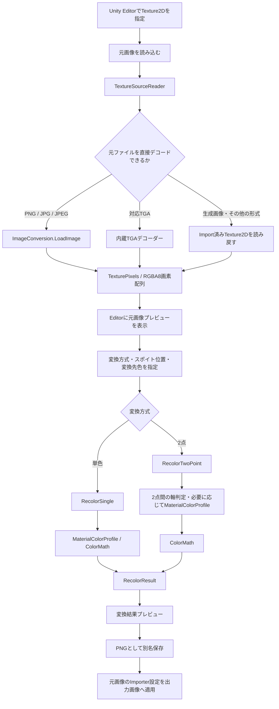

内部構造と処理フロー
本ページでは、Unity Assist Texture Color Engine 0.1.0-preview.6 のソースコードをもとに、Editor UIからテクスチャ読み込み、色解析、変換、PNG出力までの構造を説明します。
1. 全体構成
本ツールは、Unity Editor上の操作を担当する Editor層 と、ピクセル単位の色解析・変換を担当する Runtime層 に分離しています。
UnityAssistTextureColorEngine/
├── Editor/
│   ├── TextureColorEngineSandboxWindow.cs  # Unity Editor UI・操作制御
│   └── TextureSourceReader.cs              # 元画像の読み込み・PNG出力
├── Runtime/
│   ├── ColorTypes.cs                       # 色・ピクセル・結果データ型
│   ├── ColorMath.cs                        # sRGB / Linear RGB / OKLab / OKLCH変換
│   ├── MaterialColorProfile.cs              # テクスチャ内の色分布解析
│   └── TextureColorEngine.cs                # 単色・2点変換の処理本体
└── Tests/Editor/
    └── TextureColorEngineTests.cs           # 色変換コアのEditorテスト
層・クラス	役割
TextureColorEngineSandboxWindow	Texture2Dの指定、変換方式の選択、元画像上のスポイト操作、変換先色の指定、プレビュー表示、保存操作を担当します。
TextureSourceReader	元ファイルのデコード、TextureImporter設定の取得、変換結果のPNG出力、出力画像へのImporter設定の適用を担当します。
TexturePixels / Rgba32	Unity Editor UIから独立した、幅・高さ・RGBA8画素配列を保持します。画素配列はフラットな行優先配列です。
ColorMath	sRGBとLinear RGBの変換、OKLab・OKLCH間の変換、色域判定・色域マッピングを担当します。
MaterialColorProfile	スポイトした色と画像全体の分布から、明度帯ごとの色相・彩度の傾向を解析します。
TextureColorEngine	解析結果を使い、単色変換または2点変換を画素単位で実行します。
RecolorResult	変換後の画像と、対象・部分適用・不透明ピクセル数を保持します。

Runtime層は`UnityEditor`のUIに依存しません。Editor層が画像を`TexturePixels`へ変換して渡し、Runtime層は画素データを受け取って変換結果を返します。この分離により、色変換ロジックと画面操作を別々に扱える構造にしています。
2. 処理フロー

3. 元テクスチャの読み込み
読み込み処理は`TextureSourceReader.Load()`が担当します。読み込み時には、元画像のパスだけでなく、`TextureImporter`の設定も`TextureImportSettingsSnapshot`へ保存します。

読み込み経路は次のとおりです。
1. PNG / JPG / JPEG：ファイルのバイト列を読み、Unityの`ImageConversion.LoadImage`でデコードします。
2. TGA：内蔵デコーダーで読み込みます。非圧縮またはRLEのTrue Color 24/32bit、Grayscale 8bitが対象です。
3. 生成テクスチャ・上記以外の形式：UnityにImport済みの`Texture2D`を`RenderTexture`へ描画し、`ReadPixels`で画素を読み戻すフォールバック経路を使います。この場合、Import時の圧縮やMax Sizeの影響が残る可能性があるため、UIに警告を表示します。
読み込んだ画素は`sRGB RGBA8`として`TexturePixels`に格納します。画素数の上限は16,777,216ピクセルです。元画像がLinear設定の場合も警告を表示し、本ツールがBaseColor向けのsRGB画像を前提としていることを伝えます。
4. スポイトと変換処理の呼び出し
元画像プレビュー上のクリック位置を、元テクスチャのピクセル座標へ変換します。単色方式では1点、2点方式では始点と終点の2点を記録します。

変換先の色はUnity標準のColor Pickerで指定します。Editor層で選択色を`sRGB RGBA8`の`Rgba32`へ変換してから、Runtime層へ渡します。変換先色のアルファは不透明値として渡されますが、実際の変換では元画素のアルファ値を保持します。
- 単色方式：`TextureColorEngine.RecolorSingle()`を呼び出します。スポイト位置を基準に`MaterialColorProfile`を構築し、画像内の各画素に対して選択重みと変換後の色を計算します。
- 2点方式：`TextureColorEngine.RecolorTwoPoint()`を呼び出します。始点・終点の色差から、明度・彩度・色相のうち変化軸として有効なものを判定します。色相が変化軸でない場合は、画像に合わせた色相プロファイルも利用します。
各方式の判定条件と色の計算式は、[OKLab・OKLCHを用いた色変換](./03_OKLAB_OKLCH_COLOR_CONVERSION.md)で説明します。スポイト点が透明度16未満の場合は選択できず、変換処理でも透明度16未満の画素は対象外になります。
5. 変換結果のプレビューと保存
Runtime層は、変換後の画素配列を`RecolorResult`として返します。Editor層はその画素配列からプレビュー用`Texture2D`を作成し、元画像と並べて表示します。

プレビューと保存は、どちらも同じ`RecolorResult.Image`を使用します。保存時に別の色変換処理を実行する構造ではないため、プレビューに使った変換結果をPNGとして出力します。

PNG出力では次の処理を行います。
1. 変換結果から一意なファイル名のPNGを生成します。
2. 元画像が`Assets`配下にある場合は原則として同じフォルダーへ、`Packages`配下など書き込みに適さない場所にある場合は`Assets`へ保存します。
3. 読み込み時に取得した`sRGB`、Max Size、圧縮、Mip Map、Alpha、Filter、WrapなどのImporter設定を出力画像へ適用して再インポートします。
4. 元画像ファイル自体は上書きしません。
6. 設計上の境界と制限
- 色変換コアは画素の色分布を解析しますが、メッシュ、UVアイランド、衣装パーツの意味を認識するものではありません。
- 同じような色分布を持つ別パーツが1枚のテクスチャに含まれる場合、色情報だけでは完全に区別できません。
- AI、Sentis、AIセグメンテーション、手動マスク編集UIは、この`0.1.0-preview.6`パッケージには含まれていません。
- ピクセル処理は配列を走査して実行します。大きな画像ではメモリと処理時間が増加します。チャンク処理、キャンセル、並列化は実装されていません。
- PNG/JPG/JPEG/TGA以外の画像はImport済みTexture2Dからの読み戻しになる場合があり、元ファイルそのものの画素値と一致しない可能性があります。
7. 確認範囲について
このページは`0.1.0-preview.6`のソースコード構成と処理を説明したものです。ソース内にはEditorテストが用意されていますが、パッケージのBuild ReportではUnity Editor上での実コンパイル・操作確認は未実施と記録されています。ソース構造の説明と、特定のUnity環境での動作保証は区別しています。
