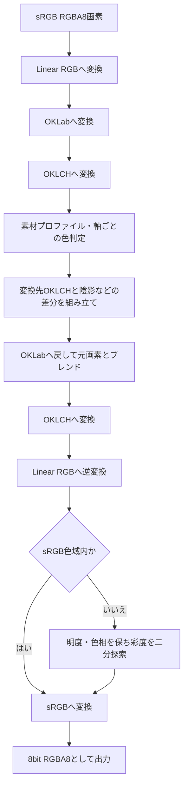

OKLab・OKLCHを用いた色変換の仕組み
本ページでは、Unity Assist Texture Color Engine 0.1.0-preview.6 が、テクスチャ内の色をどのように判定し、別の色へ変換するかを説明します。

このエンジンでは、画像の入出力形式を`sRGB RGBA8`とし、色の解析・変換計算にはLinear RGB、OKLab、OKLCHを使用します。色の対象判定と変換後の色の生成は別の段階として処理します。
1. なぜOKLab・OKLCHを使うのか
RGBはディスプレイ表示や画像データの保存に適した表現ですが、R・G・Bの数値差をそのまま色の見た目の差として扱うのには向いていません。RGB値の距離だけで対象色を選ぶと、明るさが異なる影やハイライトを同じ素材色としてまとめにくくなります。

OKLabは、明度に相当する`L`と、色味の方向を表す`a`・`b`で色を表します。OKLCHはその`a`・`b`を極座標に変換し、色味を彩度`C`と色相`H`に分けた表現です。
表現	成分	このツールでの用途
Linear RGB	R / G / B	sRGBのガンマ特性を外した線形光量として、OKLab変換の前後に使用します。
OKLab	L / a / b	色空間の変換・中間色の補間に使用します。
OKLCH	L / C / H	明度・彩度・色相を独立した条件として評価し、変換先の色を組み立てます。

- L（Lightness）：知覚的な明るさを表す成分です。
- C（Chroma）：色味の強さを表す成分です。値が小さいほど無彩色に近づきます。
- H（Hue）：色相角です。度数で扱い、0〜360度に正規化します。
OKLabは変換や補間に、OKLCHは色相・彩度・明度を個別に扱う判定や調整に利用します。単純なRGB距離、または単一のOKLabユークリッド距離だけで対象画素を決める設計ではありません。
2. sRGBからOKLab・OKLCHへの変換
処理の入口は、画像の各画素に含まれる8bitのsRGB値です。sRGB値をそのままOKLabの式へ入れるのではなく、まずLinear RGBへ変換します。
2-1. sRGBからLinear RGB
各チャンネルのsRGB値を0〜1の範囲に正規化して、次の伝達関数で線形化します。
\[
C_{lin}=\begin{cases}
\frac{C_{srgb}}{12.92} & C_{srgb}\leq 0.04045 \\
\left(\frac{C_{srgb}+0.055}{1.055}\right)^{2.4} & C_{srgb}>0.04045
\end{cases}
\]
実装では、8bit sRGBの全256値に対する変換結果をルックアップテーブルに保持し、ピクセルごとに毎回べき乗計算を行わないようにしています。
2-2. Linear RGBからOKLab
Linear RGBをLMSに相当する3成分へ変換し、それぞれの立方根を取った後、OKLabの`L`・`a`・`b`を求めます。
\[
\begin{aligned}
l &= 0.4122214708R + 0.5363325363G + 0.0514459929B \\
m &= 0.2119034982R + 0.6806995451G + 0.1073969566B \\
s &= 0.0883024619R + 0.2817188376G + 0.6299787005B
\end{aligned}
\]
\[
l'=\sqrt[3]{l},\quad m'=\sqrt[3]{m},\quad s'=\sqrt[3]{s}
\]
\[
\begin{aligned}
L &= 0.2104542553l' + 0.7936177850m' - 0.0040720468s' \\
a &= 1.9779984951l' - 2.4285922050m' + 0.4505937099s' \\
b &= 0.0259040371l' + 0.7827717662m' - 0.8086757660s'
\end{aligned}
\]
2-3. OKLabからOKLCH
OKLabの`a`・`b`を極座標に変換します。
\[
C=\sqrt{a^2+b^2}
\]
\[
H=\operatorname{atan2}(b,a)\times\frac{180}{\pi}
\]
色相は0〜360度に正規化します。彩度がほぼ0の無彩色では色相が安定しないため、実装では極小の`C`に対して`H=0`として扱います。
3. 色の対象判定
色変換では、スポイトした色に似た画素を選ぶだけでなく、テクスチャ内で同じ素材色が明暗によってどのように変化しているかを考慮します。対象判定は単色方式と2点方式で異なります。
3-1. 単色方式：明度帯ごとの素材色プロファイル
単色方式では、スポイトした1画素を基準に`MaterialColorProfile`を構築します。画像の明度を16段階に分け、各明度帯で色相と彩度の分布を調べます。
1. スポイト色をOKLCHへ変換し、基準となる色相・明度・彩度を取得します。
2. 画像を走査し、透明度が低い画素と基準色相から大きく離れた画素を除外しながら、明度帯ごとの色相ヒストグラムを作ります。
3. 各明度帯で色相の代表値を求めます。これにより、布の影やハイライトで色相が少しずれる傾向を考慮します。
4. 代表色相の近傍にある画素から彩度分布を集計し、中央値、下側・上側の範囲、色相のばらつきを求めます。
5. データが少ない明度帯は近くの明度帯のプロファイルを引き継ぎます。
このプロファイルと各画素のOKLCHを比較し、次の重みを組み合わせて選択重みを計算します。
- 色相が、その明度帯の代表色相に近いか
- 彩度が、その素材で観測された範囲に入っているか
- 彩度が低すぎず、黒や灰色などの無彩色に近い画素ではないか
- 彩度が高すぎて、別の色要素が混ざっていないか
各条件の重みを掛け合わせるため、色相だけが近い黒・灰色が有彩色の素材として選ばれることを抑えます。スポイト色の彩度が非常に低い場合は色相を判定軸にできないため、明度と彩度を中心にした狭い判定へ切り替えます。
3-2. 2点方式：始点と終点の間の色の流れ
2点方式では、変換元の始点と終点をそれぞれOKLCHへ変換し、両者の差から変化軸を判定します。
軸	変化軸として使用する条件
明度 L	始点と終点の差が0.045以上
彩度 C	始点と終点の差が0.025以上
色相 H	始点と終点の差が5度以上

いずれの差も小さい場合は、2点の色が近すぎるため変換を開始せず、別の色を選ぶようエラーにします。

有効な軸ごとに独立した範囲判定を行います。明度・彩度は始点と終点の範囲を基準にし、範囲の外側には滑らかな減衰を設けます。色相が変化軸である場合は、色相環上で始点から終点へ向かう短い方向の弧を使います。色相が変化軸でない場合は、単色方式と同様に、画像から推定した明度別の素材色相プロファイルを利用します。

各軸の判定重みを掛け合わせた値が、画素への適用重みになります。これにより、色相だけ、または明度だけで無関係な画素を広く巻き込むことを抑えています。
4. 変換後の色の組み立て
対象と判定された画素を一律に変換先色へ置き換えるのではなく、元画像の陰影や素材感を残すため、変換先の色へ元の明暗差などを少し加えます。
4-1. 単色方式
変換先色をOKLCHへ変換し、各画素について次の要素を組み立てます。
- 明度：変換先の明度に、スポイトした基準画素からの明度差を加えます。
- 彩度：明度帯ごとの素材色の中央値に対して、その画素がどの程度の彩度を持つかを比率で求め、変換先の彩度へ弱く反映します。
- 色相：その明度帯の代表色相からの小さなずれを、変換先の色相へ弱く引き継ぎます。
内部設定の初期値は、陰影保持率`0.76`、色相の変化保持率`0.12`、彩度の変化保持率`0.12`です。これらは通常の操作画面で調整するスライダーではなく、エンジン内部の設定値です。
4-2. 2点方式
2点方式では、各画素が始点から終点までの色の流れのどこに位置するかを、使用中の変化軸から求めます。その進行度`t`を使い、次の2つの中間色を作ります。
- 変換元の始点色と終点色の間を補間した「期待される元色」
- 変換先の始点色と終点色の間を補間した「期待される変換先色」
色相を補間するときは、0度と360度をまたぐ場合でも不自然に一周しないよう、最短方向の角度差を使います。

そのうえで、画素が期待される元色から持っている明度差・色相差・彩度比を弱く残し、期待される変換先色へ反映します。始点・終点の画素は、それぞれ指定した変換先の始点色・終点色に正確に対応させます。
5. 適用重みと元画素とのブレンド
色の対象判定で得た重みを`weight`とします。対象外の画素は変更せず、対象として選ばれた画素は元の色と変換後の色をOKLab上で補間します。
\[
Lab_{out}=Lab_{source}+(Lab_{recolored}-Lab_{source})\times weight
\]
weightが小さい境界部分は元の色を多く残し、重みが大きい部分ほど変換後の色へ近づきます。判定重みを持つことにより、色範囲の境界に急な切り替わりが発生しにくい構造です。

透明度が`16`未満の画素は変換対象から除外し、そのRGBA値を維持します。スポイトした画素（2点方式では両端点の画素）はアンカーとして扱い、指定した変換先色のRGB値へ正確に対応させます。通常の画素変換でも、出力アルファは元画素の値を使用します。
6. OKLCHからsRGBへの逆変換と色域マッピング
OKLCHで組み立てた色は、OKLabへ戻した後、Linear RGBへ逆変換します。その値がsRGBで表現できる範囲（各Linear RGBチャンネルが概ね0〜1）に収まっているかを確認します。

OKLabからLinear RGBへの逆変換では、まず次の3成分を求め、それぞれを3乗してからRGBへ変換します。
\[
\begin{aligned}
l &= L + 0.3963377774a + 0.2158037573b \\
m &= L - 0.1055613458a - 0.0638541728b \\
s &= L - 0.0894841775a - 1.2914855480b
\end{aligned}
\]
\[
\begin{aligned}
R &= 4.0767416621l^3 - 3.3077115913m^3 + 0.2309699292s^3 \\
G &= -1.2684380046l^3 + 2.6097574011m^3 - 0.3413193965s^3 \\
B &= -0.0041960863l^3 - 0.7034186147m^3 + 1.7076147010s^3
\end{aligned}
\]
指定色がsRGBの色域外にある場合、RGBチャンネルを個別に単純クリップするのではなく、明度Lと色相Hを保ちながら彩度Cを下げる方向で色域内へ収めます。実装では彩度の範囲を二分探索し、14回の反復で色域内に入る彩度を求めます。

その後、Linear RGBをsRGBへ戻し、8bit値へ量子化します。逆変換側にも4096段階のルックアップテーブルを使い、変換後のRGB値を取得します。

色域マッピングの優先順位は、変換先の色相と明度をできるだけ維持し、表現できない色の強さを彩度側で調整することです。すべてのディスプレイや素材で元の色を完全に再現することを保証するものではありません。
7. 変換処理の全体像

8. この方式でできること・できないこと
できること
- 明るさが異なる影・中間色・ハイライトを、明度帯ごとの素材色分布を使って同じ色系統として扱うこと。
- 色相・彩度・明度を別々の条件として組み合わせ、単純な色差半径だけに依存しない対象判定を行うこと。
- 変換後も元画像の陰影や微細な色の変化を一定程度残すこと。
- 変換先がsRGB色域外になる場合に、RGB各チャンネルの独立クリップではなく、OKLCHの彩度調整で色域内へ収めること。
できないこと・保証しないこと
- 画素の色だけを手掛かりにするため、同じ色を持つ別パーツを意味的に判別すること。
- UVアイランド、ポリゴン、メッシュ、アバター上の部位を認識して選択すること。
- Normal、Mask、Metallicなど、BaseColor以外のLinearデータを正しく色変換すること。
- すべてのテクスチャで意図した領域だけが必ず選択されること、またはあらゆる色域外の色が完全に再現されること。
9. 実装上の補足
- 主な実装：`Runtime/ColorMath.cs`、`Runtime/MaterialColorProfile.cs`、`Runtime/TextureColorEngine.cs`。
- 入出力画素はsRGB RGBA8です。色の計算中にLinear RGB・OKLab・OKLCHへ変換します。
- 色判定用の重みと色変換用の補間は別々に計算します。
- このページは`0.1.0-preview.6`に含まれるソースコードの説明です。数式・処理構造の説明は、Unity上での実機動作検証や全テクスチャに対する品質保証を意味しません。
